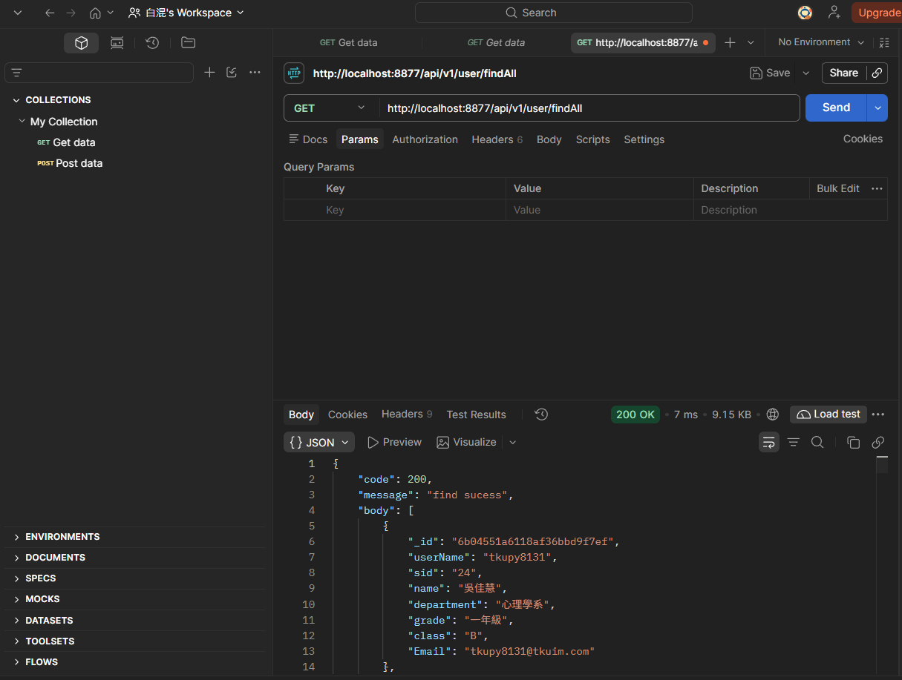
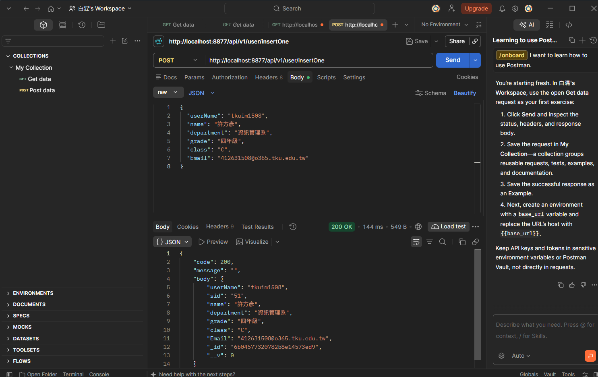

# Postman 測試說明

- 學號：412631508
- 姓名：許方彥
- 測試環境：Windows 11、Docker（MongoDB 8）、後端 `http://localhost:8877`
- 測試資料：匯入 `studentslist.csv` 共 50 筆

## 1. findAll

`GET http://localhost:8877/api/v1/user/findAll`

結果：`200 OK`，`message` 為 `find sucess`，`body` 為學生資料陣列。



## 2. insertOne

`POST http://localhost:8877/api/v1/user/insertOne`

Body（raw / JSON）：

```json
{
  "userName": "tkuim1508",
  "name": "許方彥",
  "department": "資訊管理系",
  "grade": "四年級",
  "class": "C",
  "Email": "412631508@o365.tku.edu.tw"
}
```

結果：`200 OK`，新增的學生 `sid` 為 `51`。



## 環境設定備註

`BackEndExample/src/utils/MongoDB.ts` 的連線字串使用 `authSource=admin`，因此 `studenthub_app` 帳號要建立在 `admin` 資料庫。實測若建立在 `studenthub`，API 會回傳 500。

```javascript
use admin
db.createUser({
  user: "studenthub_app",
  pwd: "<自訂密碼>",
  roles: [{ role: "readWrite", db: "studenthub" }]
})
```
